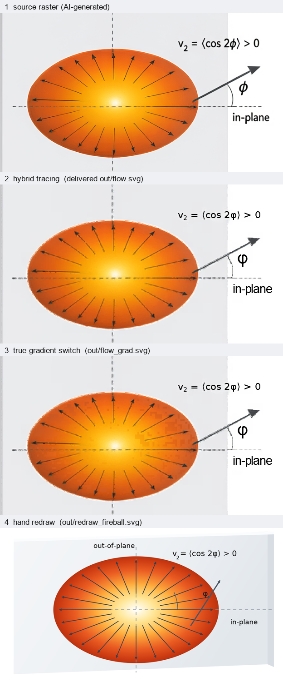
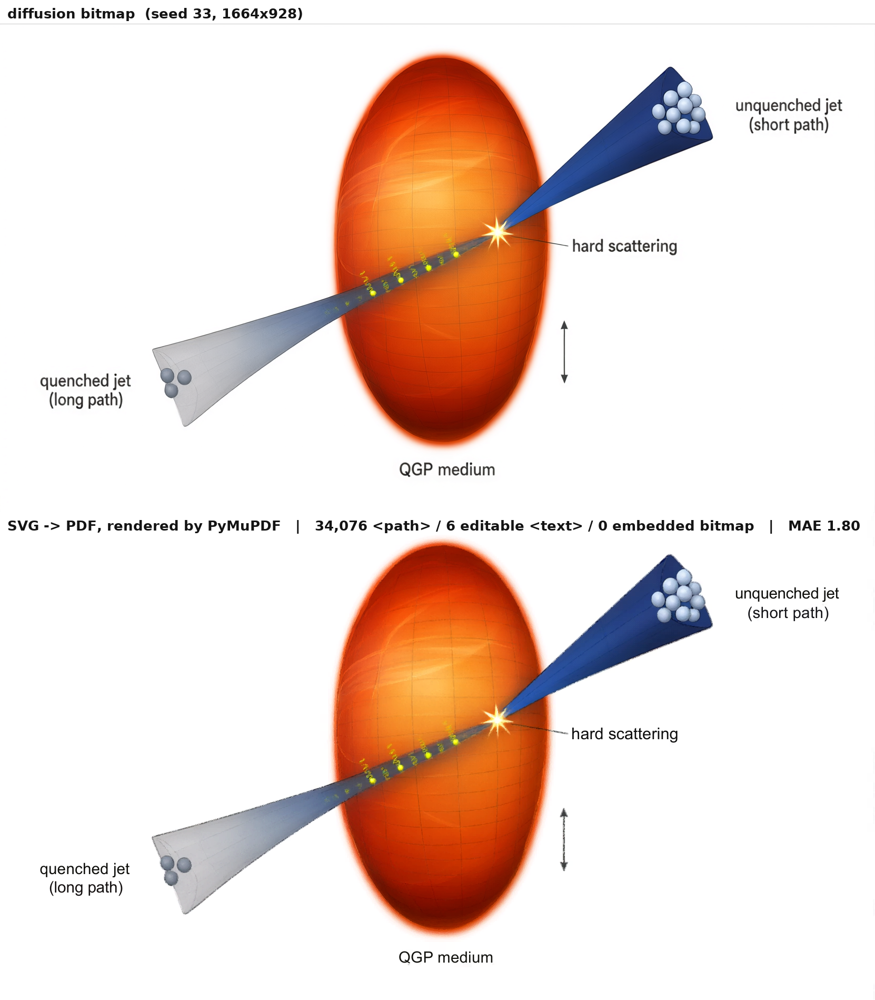
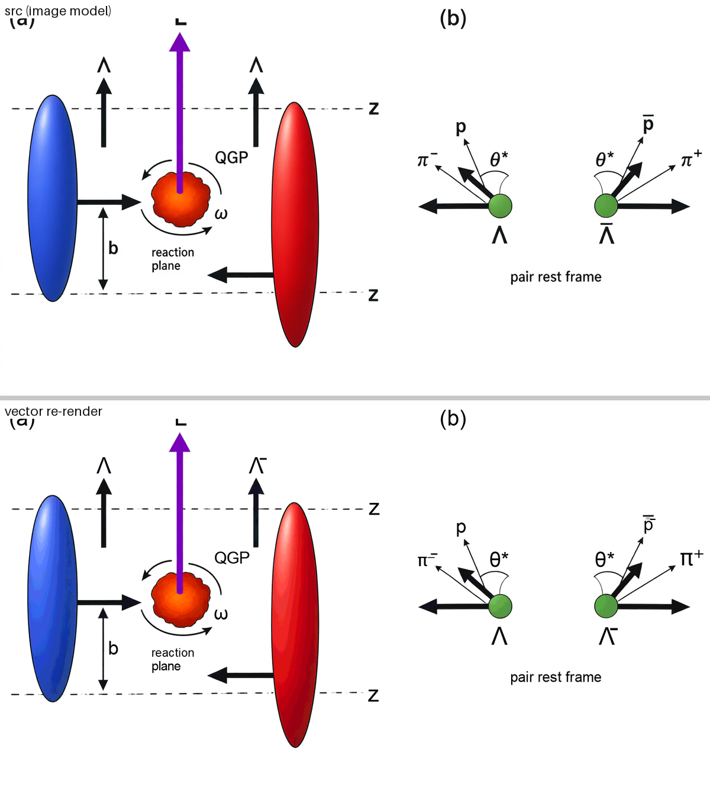
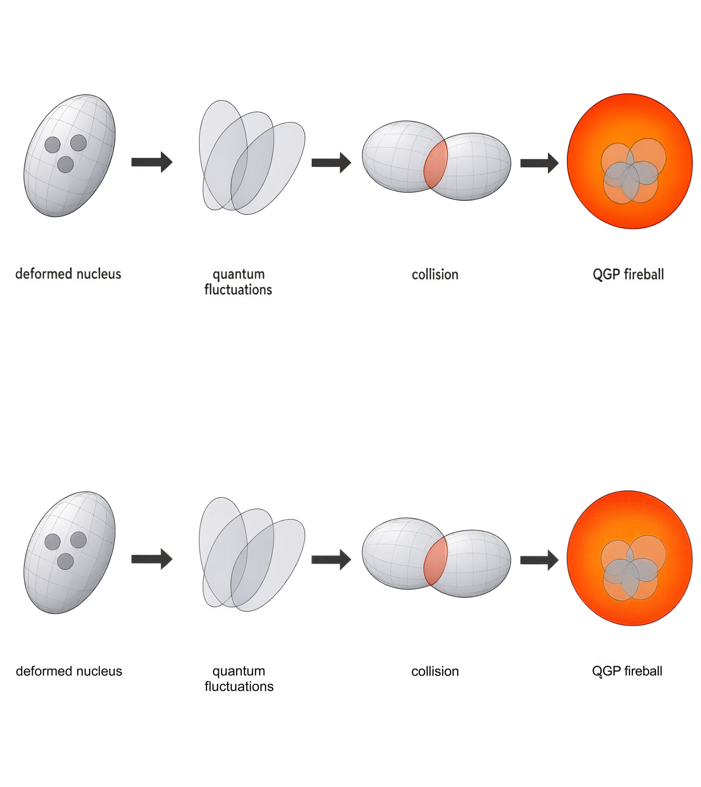
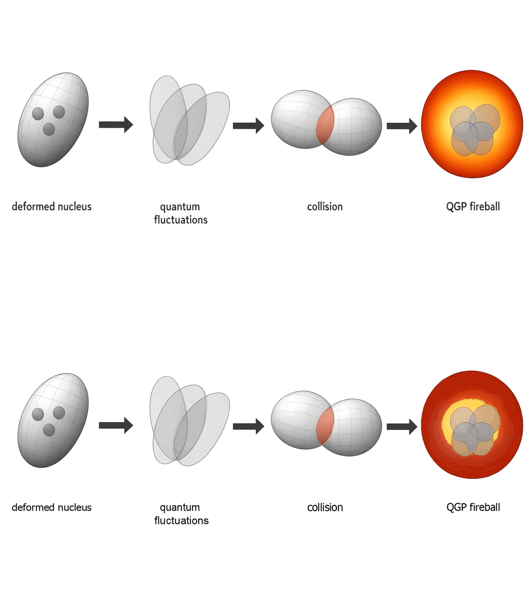
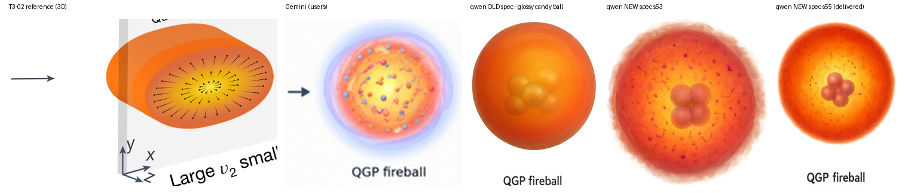
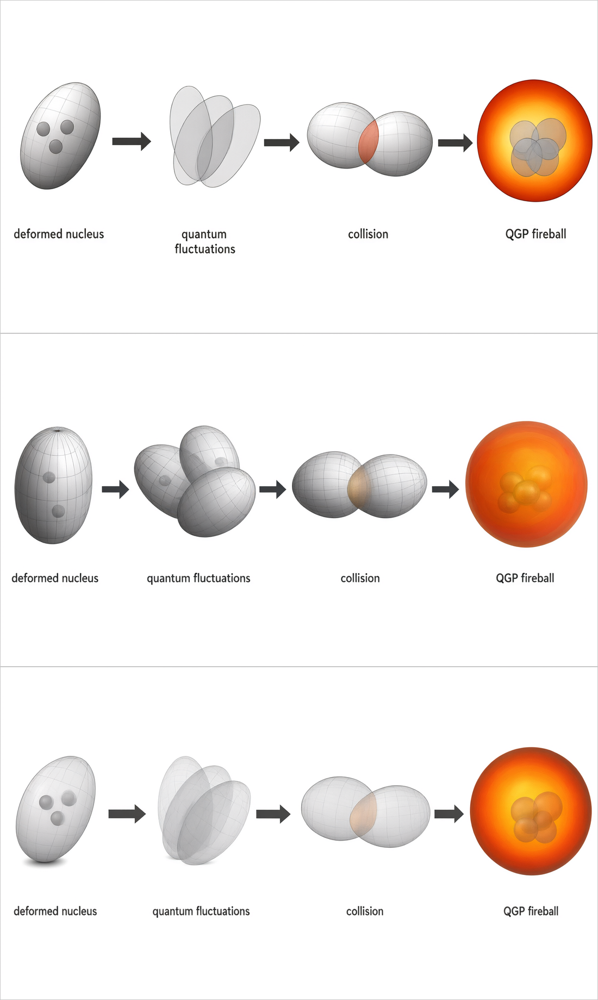
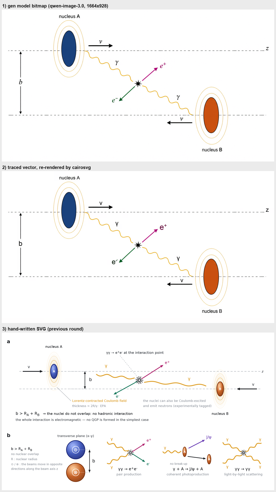
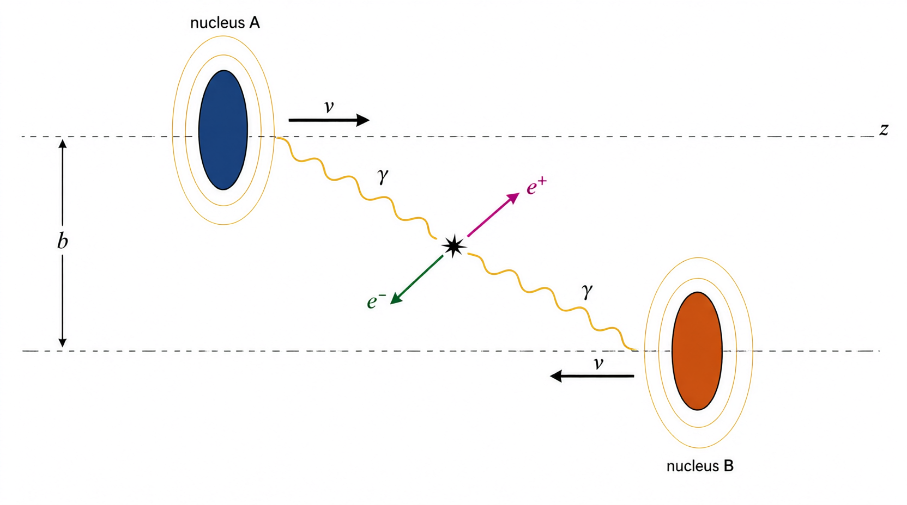
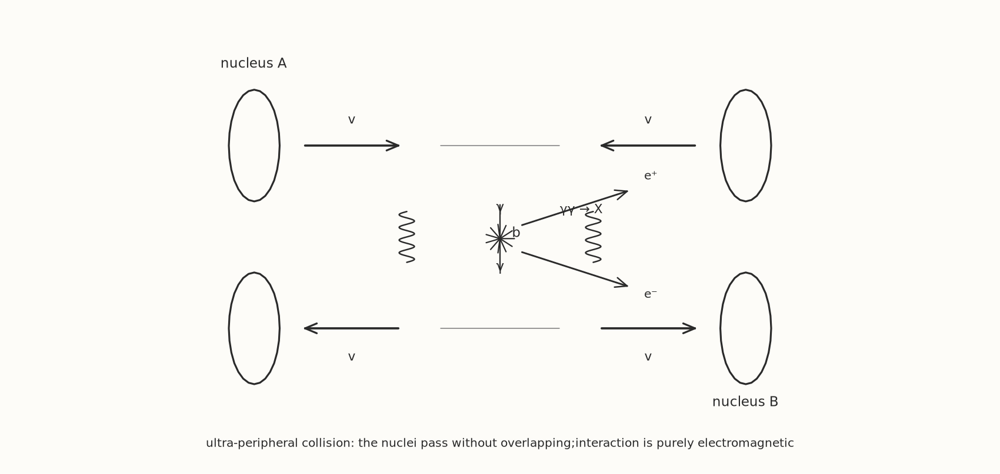

# hep-nature-figure

**面向高能核物理 3D 示意图的配图 Skill。** 从手绘草图或物理描述出发，在草图和成品上核对几何关系，保留复杂的光照与渐变，并交付零嵌入位图的 SVG 与按物理对象分层的编辑稿。

当前主线为 [v4.28](CHANGELOG.md#v428--2026-11-18)，新装请用 `main`。早期的 `route-a`、`route-b1`、`route-b2` 仅作历史保留。

[](LICENSE)

---

## 这个 skill 解决什么问题

做科研配图的痛点不是"不会画"，是**花太多时间画**；而且 AI 直接画往往
**"花里胡哨但物理表达不准确"**。

本 skill 的做法：**在动手之前，先把"这张图在物理上表达什么"写成结构化的 IR**，
画完再用**可判定的门禁**验收。

---

## 什么时候用它 / 适合做什么

- **画投稿级示意图** —— 碰撞 / QGP / 介质响应 / 喷注淬火 / 涡旋与整体极化 / 手绘草图转配图。
- **复现已有论文配图** —— 给一张参考图（或论文 PDF），先提取 IR 再生成，并附偏离量化。
- **要 3D 质感的示意图** —— 带光照、渐变、圆柱 / 火球 / 核子气这类"代码拼不出质感"的图。
- **多面板复合图** —— 面板标签、拼版保矢量（`assemble_panels.py`）。
- **交付格式检查** —— 是不是纯矢量、文字能不能提取、最小字号、有没有嵌入位图、构图是否重叠。
- **要一张"能改"的图** —— 图层按**物理元素**分组（`nucleus-A` / `photon-B` …），不是按颜色分层。

**不适合**：纯统计图（直方图 / 散点 / 热图）、交互式 dashboard、物理还没想清就要"一键出图"。

## 典型请求

- "参考 `_T3精选` 里的风格，画一张超边缘碰撞（UPC）的物理示意图。"
- "把这张手绘草图做成 Nature 级的 3D 配图，导 SVG + PDF。"
- "复现这张论文图（贴图），给我可编辑矢量，并说明哪里对不上。"
- "用最新的 skill 再跑一次自旋关联的示意图。"（→ 默认走路线③）
- "这张图除了文字都必须是矢量，渐变和阴影要保住。"
- "查一下这张图的 PDF 合不合投稿要求（矢量 / 字号 / 嵌入位图）。"

---

## ★ 分工：谁画、谁约束、谁验收

**图像模型负责质感；IR 和检查脚本约束物理，作者决定构图。** 可参数化的图也可直接用 SVG 绘制。

| 环节 | 谁做 | 为什么 |
|---|---|---|
| **画** | **模型** | 有视觉先验，能做出代码拼不出的质感 |
| **约束** | **IR + `geometry_constraints`** | 防"好看但物理错"——模型单干最爱犯 |
| **验收** | **物理、构图和交付检查** | 核对可量化关系，检查文字、图层和渲染 |
| **返修** | **`repair_brief.py` → 模型改** | 光说"文字重叠"模型只能猜；返修单给归一化坐标 + 具体改多少 |

> 复杂材质适合用图像模型生成；要求几何精确或便于扫描参数时，可直接绘制矢量。

### 喷注淬火：同草图、同模型 A/B

同一张草图、同一个模型，只差"用不用本 skill"：

| | 不调用 skill | 调用 skill |
|---|---|---|
| 观感 | 一样漂亮 | **一样漂亮** |
| 几何约束 6 项 | **过 2 项** | **过 6 项** |

不调 skill 那版的具体违规：加了 IR 禁止的装饰元素、喷注端点出界、
胶子辐射画在了两条喷注上（应只有淬火那条）、两喷注夹角 173°（应 180°）、
**表面偏置丢了**（|v−C|/R = 0.85，应有 0.72 —— 而这是整张图的物理）。

---

## 完整流程（路线 3）

```
输入（参考图 / 草图 / 描述）
   ↓
① 写 IR —— 物理层 + 元素 + 构图 + geometry_constraints
      用结构化规格记录科学表达；生图简报从 IR 编译
   ↓
② IR → 约束简报              scripts/ir_to_genbrief.py --stage sketch
   ↓
③ 出候选草图：无作者草图走 A→D（文字、风格、替换、物理修正）；
   有作者草图走 A→E（草图+一句话、同句纯文字、风格、从 A/B/C 选元素、物理修正）。
   输入与账本规则见 references/routing.md。
                             scripts/gen_figure.py --stage sketch
   ↓
④ ★ 草图矢量化 —— 人可改的 SVG 草图（必须输出）
                             scripts/sketch_to_vector.py
   ↓
⑤ ★ 闸口①：草图过物理检查（不能跳）      scripts/check_sketch.py
   ↓
⑤.5 ★★ 交接点：候选草图 → 你挑 / 你改   scripts/sketch_handoff.py（交出去）
       你改完传回 → 重过闸口①再用         scripts/sketch_ingest.py（灌回来）
       ★ 你点一下 → 留下**回执**才算问过      scripts/make_picker.py / scripts/choice_gate.py（v3.1）
   ↓
⑥ 出成品位图（--content-ref 草图 + --ref 风格） scripts/gen_figure.py --stage render
      ★ 简报侧先定风格档：ir_to_genbrief.py --stage render --style-mode auto
        （IR 写 3D/半写实 -> render3d 出 3D 渲染简报；参考图是风格书，不是内容模板）
   ↓
⑦ ★ 闸口②：成品位图再过一次同一个闸口    scripts/check_sketch.py --sketch 成品位图
      ★ 多张备选先机器排序（人眼只审没硬伤的）    scripts/pick_best.py
   ↓
⑧ 位图 → 矢量：确认的位图 → 按物理元素临摹 → 从临摹层重建
   同色或弱边界先审计；输出 visual master、edit master、pick 层及校验清单
   ↓
⑨ 交付检查 + 返修单 → 交付（SVG 工作稿 + PDF 成品）
```

**为什么要这两道闸口**：机器判不了物理。草图阶段先拦一次"元素缺失 / 喷注画反"，
成品位图阶段再拦一次"生图模型自作主张改了物理"。**闸口不是装饰，是流水线上的卡尺。**

**为什么第 ④ 环要输出矢量草图**：草图是给人改的。位图草图改不动，
矢量化之后人能在 Illustrator 里直接拖动某个形体，改完再回去生成品位图。

---

## 三条路线，怎么选

|  | **路线 1：直接代码出图** | **路线 2：生图草图 → 代码完善** | **路线 3：生图草图 → 成品位图 → 临摹** |
|---|---|---|---|
| 中间产物 | 无 | 草图 PNG + **矢量草图 SVG** | 草图 PNG + **矢量草图 SVG** + 成品位图 |
| 谁保证物理 | 代码（`geometry_constraints` 直接可算） | 闸口① | 闸口① + 闸口② |
| 适合 | 精确、可参数化的图形 | 先探索视觉方案，再手工控制几何 | 需要保留生成位图的复杂光照和材质 |
| 成本 | 低 | 中 | 高 |

- **需要按选定草图生成复杂光照和材质** → 路线 3，是 3D 生图任务的默认选择。
- **要批量扫参数 / 要代码直渲** → 路线 1（`scene_render.py` IR 直渲，或 `svg_lib` 手写）
- **要人插手改草图** → 路线 2（矢量草图交给人在 Illustrator 里改，再代码完善）

> 路线 2 和 3 的**前两段完全一样**（IR → 简报 → 生图 → 矢量草图 → 闸口①）。
> 区别只在第三段：2 是代码接着完善草图，3 是多跑一张成品位图再矢量化。
> 路线 3 最耗时，且草图进入成品渲染之前需要作者确认；确认后的位图是后续保真重建的依据。

> ⚠️ **生图 key 由使用者自备**（环境变量 `DASHSCOPE_API_KEY`），skill 里不存任何 key；
> 没 key 也能 `gen_figure.py --dry-run` 走通全流程自检。


---

## 位图 → 矢量：保观感，也能改对象

路线 3 先用 `raster_to_vector_semantic.py` 按物理对象临摹选定的位图，再从临摹层的掩膜重建几何。v4.27 在临摹前审计同色、弱边缘和遮挡次序的冲突，记录边界调整及其置信度。文字以真正的 SVG 文本保留。复杂光照可用沿对象轮廓裁切的矢量渐变带重建，不需要把整块对象作为 PNG 嵌入。

| 交付物 | 用途 |
|---|---|
| **Visual master** | 尽量保留源图的光照、渐变与轮廓，用于生成成品 PDF |
| **Edit master** | 按物理对象编辑形状、位置和基色 |
| **Pick 层** | 一次点击选中一个物理对象 |
| **发布清单** | 记录源文件、冲突报告和产物哈希，供 `release_gate.py` 检查 |

改动编辑稿后，用 `edit_to_visual.py` 重新生成成品与拾取层。当前支持改色、平移、缩放和适度形变；完全遮挡的几何和不存在于源图中的纹理无法可靠恢复。复杂图仍可能需要人工校正元素分区或文字；评估保真时，应看对象和边界区域的误差，避免白底稀释全图误差。详见[矢量流程](references/bitmap-to-vector.md)及 [v4.27 发布说明](CHANGELOG.md#v427--2026-11-11)。

### 如何和其他工具比较

| 任务 | 对照方法 | 本项目的侧重点 |
|---|---|---|
| 草图 → 3D 成品位图 | [Adobe Firefly 构图参考](https://www.adobe.com/learn/firefly/web/sketch-to-ai-generated-image)可控制轮廓和布局。 | 分开指定构图和风格，作者先选或改草图，再核对投影、束流和喷注路径等物理关系。 |
| 高渐变位图 → 可编辑 SVG | [AutoFigure-Edit](https://arxiv.org/abs/2603.06674)重建科研图布局，可把分割出的复杂图标作为[透明 PNG 嵌入 SVG](https://github.com/ResearAI/AutoFigure-Edit/blob/16f3749e9d512bdf7b7b55c162307bc289750b7a/autofigure2.py#L2807)，便于移动整个组件。 | 对复杂明暗做纯矢量重建；在保真成品之外，交付按物理对象可修改的编辑稿。 |
| 通用位图描摹 | [VTracer](https://github.com/visioncortex/vtracer)适合快速得到路径，可按精度和体积调参。 | 把文字保留为文字、按物理对象分层，并检查重建后的几何和交付格式。 |

已有证据是上面的喷注淬火 A/B（几何约束由 **2/6** 项提升至 **6/6**）和[复杂光照的 3D 火球算例](assets/demos/evo3d_smooth/)（无嵌入位图、4 个可编辑文字对象，PDF 回渲染的火球区域 MAE 为 **2.78 / 255**）。这些是具体案例，不是跨工具排行榜；项目尚未发布在相同输入和时间预算下的独立横评。

---

## 示例预览

| 方向 | 预览 | 看点 |
|---|---|---|
| **位图 → 矢量三种做法对照**（重画 / 混合临摹 / 真渐变开关） | <a href="assets/demos/flow_semantic/cmp_three_ways.png"></a> | 同一个末态火球（v2 > 0）四种做法并排：**重画** 12 KB 且**物理量是参数**（`RX, RY = R0(1 +- V2)` 一行同时定火球扁度和箭头各向异性，实测箭头比 **1.55** 是算出来的）；**混合临摹** 38,079 `<path>` / 15 `<text>` / `<image>` **0**、MAE **2.70**、6.67 MB；**真渐变开关**反而更差（右火球 MAE **6.48 -> 7.28**、体积 6.67 -> 6.64 MB —— 占体积的是抗锯齿碎屑，换渐变省不到） |
| **喷注淬火 / 双喷注不对称**（路线③，v2.7.2） | <a href="assets/demos/jet_quenching/cmp_bitmap_vs_svg.png"></a> | 新闸口**机器量出「IR 自己把几何写反了」**：按 IR 给的端点算，被淬火那侧只有 0.09W 就出射、另一侧反而 0.30W，3/3 草图一致照抄。修 IR 后弦长比 **4.00x**；34,076 `<path>` / **6 `<text>`** / `<image>` **0**，PDF 全图 MAE **1.797** |
| 自旋关联示意图（路线③ 全过程） | <a href="assets/demos/spin_semantic/cmp_preview.png"></a> | 上 = 生图模型的成品位图，下 = 临摹矢量回渲染；非文字区 MAE **0.518**、`<image>` **0** |
| 形变核 → 火球四阶段链（路线③ 全过程） | <a href="assets/demos/evo_semantic/cmp_preview.png"></a> | 上 = 成品位图，下 = 全矢量临摹；MAE **0.626**、31005 `<path>` / `<image>` **0**、PDF 183x102 mm 纯矢量 | 
| **形变核 → 火球 3D 版**（v2.6.7 风格档） | <a href="assets/demos/evo3d_semantic/cmp_bitmap_vs_svg.png"></a> | 同一份 IR + 同一张参考图，只把 `--style-mode` 判成 `render3d`：火球从**纯色圆盘**变成内亮外暗的多层半透明 3D 渐变；686 `<path>` / **5 `<text>`** / `<image>` **0**，MAE 0.994 |
| **IR 的 `material` 从没进过简报 → 火球是颗光滑糖球**（v2.6.9） | <a href="assets/demos/evo3d_fireball_spec/cmp_fireball_specs.png"></a> | T3-02 / Gemini / 旧 spec / 两个新 spec：**同一个模型、同一个 seed**，只把 `material` 写清楚并送进简报，火球内部高频能量 0.0103 → 0.0418（2.6~4 倍），从光滑糖球变成有内部结构的等离子体团 |
| **构图参考会把「扁平」当风格一起送进去**（v2.6.8） | <a href="assets/demos/evo3d_layoutref/cmp_refmodes.png"></a> | 同一份简报 / 同一 seed，只改 `--content-ref` 怎么送：原样送 → **纯色橙盘**；不送 → 3D 但构图跑掉；**降级成 layout-only → 3D 辉光 + 亮核，且构图相关 r 反而最高（0.904）**（★ v4.7 起降级改为 opt-in：它只对**扁平**草图成立；草图本身已经 3D 时降级是纯损失，见 `--content-ref-mode`） |
| UPC 示意图（三条落点并排） | <a href="assets/demos/upc_semantic/cmp_preview.png"></a> | 1 生图位图 / 2 语义临摹 / 3 代码直写 —— 同一条主线的三种落点 |
| 生图模型的成品位图（原图） | <a href="assets/demos/upc_semantic/src_upc.png"></a> | 路线③ 的中间产物：只当作"更好的草图"，它过了闸口才允许照它画 |
| 手绘草图（路线②③ 的输入） | <a href="assets/demos/sketch_upc.png"></a> | 草图只要求"构图清晰、元素齐全"，质感由后面的生图负责 |

## 你需要提供

- **物理内容** —— 这张图要表达什么（几句话也行）。它是 IR 里 `physics` 的来源，也是闸口的判据。
- **参考图 / 草图**（可选但强烈建议）—— 上一步的**草图**走 `--content-ref`（构图依据，
  出图本来就该像它；★ 出成品位图时**原样送、不降级**（v4.7 起，`--content-ref-mode auto`
  = `full`）—— 位图这一步就是对草图的润色，形体 / 材质 / 光照 / 文字都该带进去；
  只有草图本身是**扁平稿**时才显式 `--content-ref-mode layout` 去掉扁平风格）；
  **风格参考**走 `--ref`（只给配色/线条/材质）。
  复现任务要另给原图。
- **目标规格** —— 单栏 / 双栏、目标期刊、要 SVG / PDF / PNG 里的哪些。
- **生图模型的 API key**（走路线②③时）—— 本 skill **不携带、不保存**任何 key，用你自己的
  （`gen_figure.py` 读环境变量 `DASHSCOPE_API_KEY`；没 key 可以 `--dry-run` 只出自检计划）。

## 产出

- **可编辑矢量**：按物理元素分层，保留可编辑文字。语义发布链交付 visual master、edit master、pick 层和发布清单。
- **成品 PDF**（默认 183×102 mm 双栏）+ 可选 PNG 预览；提交前请核对目标期刊的图件和 AI 使用要求。
- **中间产物全部落盘**：IR、生图简报、草图 PNG、**矢量化草图 SVG**、成品位图，以及
  每个 seed 的 `calls.jsonl`（model / seed / size / refs / prompt 指纹 / 耗时）。
- **验收记录**：闸口①/② 的逐条结论、临摹自检（MAE / PSNR / 色阶差）、交付门禁、构图审计。
- **图层清单**（`*_layers.md`）：每个物理元素一行 —— 在 Illustrator / Inkscape 的图层面板里
  按名字点选就能改，不用在图里找。

---

## 安装

### Claude Code

```bash
git clone https://github.com/YuhaoPeng1103/hep-nature-figure.git \
  ~/.claude/skills/hep-nature-figure
```

或建软链：

```bash
ln -s /path/to/hep-nature-figure ~/.claude/skills/hep-nature-figure
```

装好后用 `/hep-nature-figure` 或在对话里描述任务即可触发。

### 其他平台

`SKILL.md` + `references/` 的内容是**平台无关的方法论**，可移植到
ChatGPT（Instructions + Knowledge 文件）、Cursor、Codex 等。

---

## 环境要求

**核心（必需）**：

```bash
pip install -r requirements.txt
# 或手动：
pip install numpy pillow cairosvg pymupdf matplotlib scipy shapely \
            pyyaml opencv-python
```

**按需**（不同图型需要不同工具）：

| 工具 | 用于 | 安装 |
|---|---|---|
| Inkscape | 人工精修矢量 | `sudo apt install inkscape` |
| LaTeX (pdflatex) | 公式、TikZ | `sudo apt install texlive-latex-recommended texlive-pictures` |
| Blender | 真 3D 几何 | https://www.blender.org/download/ |
| ROOT | `.root` 文件、领域惯例图 | https://root.cern/install/ |
| Asymptote | 程序化矢量图 | `sudo apt install asymptote` |
| Ipe | 公式密集的整图 | `sudo apt install ipe` |

**先用脚本探测本机有什么、缺什么该装什么**：

```bash
python3 scripts/check_tools.py
```

输出示例：

```
✅ 已可用（5）   Python+matplotlib · cairosvg · PyMuPDF · LaTeX · ROOT
❌ 缺失（6）     Inkscape · Ipe · Asymptote · Blender · Mathematica · Illustrator
                 ↑ 每项都给出对应平台的安装命令
```

> **缺工具 = 去装，不是绕开。** 这是这个 skill 的一条硬纪律。

---

## 快速开始

```bash
# 1. 看本机有什么工具
python3 scripts/check_tools.py

# 2. 从论文 PDF 切参考图
python3 scripts/extract_figures.py paper.pdf -o refs/

# 3. 写 IR（参考 references/ir-spec.md 的格式）
#    —— 这一步不可跳过，是物理正确性的保证

# 4. 按 IR 实现，渲染
#    图元库在 scripts/svg_lib.py

# 5. 迭代：与参考图并排对比
python3 scripts/compare_ref.py 参考图.png 我的图.png -o cmp.png

# 6. 交付前检查
python3 scripts/check_delivery.py fig.pdf fig.eps
```

### 多工具联合示例

```bash
python3 scripts/demo_combined.py
# 卡通示意(svg_lib) + 物理公式(TikZ) + 合成(PyMuPDF) → PDF + EPS
```

---

## 目录结构

```
.
├── SKILL.md                     路由器：判任务 → 写 IR → 选后端 → 执行 → 验证
├── CHANGELOG.md                 最近三版（更早见 docs/changelog/；每条都带实测对照）
├── requirements.txt             依赖（numpy / scipy / Pillow / shapely / cairosvg / PyMuPDF …）
├── references/                  写作与排查时翻的规范（见下面「内置参考」）
├── scripts/
│   ├── _console.py             内部：Windows 控制台编码兜底（所有脚本 import 它；拷脚本要一起拷）
│   ├── svg_lib.py               SVG 图元库（火球 / 圆柱 / 核子 / 壳 / 环 / 坐标轴 / 图层）
│   ├── geom.py                  shapely 布尔运算 → SVG path（外轮廓、有机团块）
│   ├── cartoon_lib.py           卡通示意（手绘感）图元
│   ├── scene_render.py          路线 1：IR 直渲（可批量扫参数）
│   ├── verify_scene.py          路线 1 的几何自检（量 IR 里写了数量的元素）
│   ├── ir_to_genbrief.py        IR → 生图简报（--stage sketch / render）
│   ├── ir_brief_audit.py       ★ IR → 简报的无损体检（哨兵法：字段没进简报 = IR 白写）
│   ├── ir_canvas.py            内部：IR 画布的唯一读取口（composition.canvas 优先，兼容 figure.canvas）
│   ├── gen_figure.py            ★ 第③步：生图（简报 → 草图 / 成品位图）。key 自备，支持 --ref
│   ├── trim_border.py           ★ 裁掉生图模型稳定画的 1~2px 外框（幂等）
│   ├── sketch_to_vector.py      ★ 第④步：草图矢量化成可改的 SVG（不用写 panels.py）
│   ├── sketch_handoff.py        ★★ 第⑤步前：多张草图 → 给人挑的一页 + 可编辑 SVG（v3.0 人机交接）
│   ├── sketch_ingest.py         ★★ 人改完的草图灌回流程：规范化画布 + **强制重过闸口①**（v3.0）
│   ├── make_picker.py           ★★ 客户选择入口（v3.1）：handoff 候选 → pick.html（双击可点、底栏给选择码）+ pick_sheet.png
│   ├── choice_gate.py           ★★ 客户拍板闸门（v3.1）：没有 handoff/choice.json 就不许出成品位图；--by 写 agent 判失败
│   ├── ref_guard.py             ★ 参考图角色闸门（v3.1；v4.13 加 LADDER_PREV）：--ref 只许风格书、sketch 的 --content-ref 只许手绘（+ 同一条阶梯上一轮的图）、render 的只许已过闸口①的草图；--run 先查后调
│   ├── ladder_gate.py           ★★ 提示词阶梯闸门：无作者草图 A→D；有作者草图 A→E；按账本核对档位、参考图和位图入口
│   ├── keep_gate.py             ★★ 阶梯相邻两档的「保留」对账（v4.13）：形体删除（上一版有→这一版没了）+ 质感漂移（东西还在但材质被换掉）—— 正是 L11 那条「C 档不许顺手换材质」的对账工具
│   ├── ir_layout_guard.py       ★ IR 版式锁闸门（v3.1）：把简报真的编译出来再扫「版式有没有被写死」
│   ├── check_sketch.py          ★ 闸口①/②：草图与成品位图的物理检查（可一次查多张 + --json + --sketch 量构图保真）
│   ├── pick_best.py             ★ 候选排序：吃 check_sketch --json 的报告，只把人眼留给没硬伤的
│   ├── raster_to_vector.py      位图 → 矢量（临摹备用）：逐像素 + 混合文字 + --groups
│   ├── raster_to_vector_semantic.py  位图 → 语义分层的全矢量 SVG（先理解再临摹）
│   ├── raster_vector/           上面那条的库（quadtree / labels / elements / panels / groupvec / grad_fit / raster_ops）
│   ├── check_tools.py           工具能力探测 + 装机指引
│   ├── check_render.py          渲染静默失败检测（渐变失效 / 字体丢失都不报错）
│   ├── check_delivery.py        投稿检查（矢量？文字可编辑？字号达标？）
│   ├── delivery_gate.py         风格档案门禁（偏离超限 → 阻断）
│   ├── audit_composition.py     构图审计（文字重叠 / 线穿文字 / 出界 / 留白）
│   ├── audit_panels.py          多面板对齐审计
│   ├── assemble_panels.py       复合图拼版（保矢量）
│   ├── compare_ref.py           参考图与成图并排对比
│   ├── pdf_roundtrip.py         ★ 排版后的 PDF 回渲染 vs 原成品位图（超采样 + 亚像素对齐）
│   ├── style_bench.py / style_profile.py   风格量化与建档
│   ├── auto_converge.py         自动收敛循环（量 → 定位 → 修正 → 复测）
│   ├── extract_figures.py       从论文 PDF 自动切图
│   ├── repair_brief.py          返修单（归一化坐标 + 具体改多少）
│   └── demo_*.py                多工具联合 / 喷注淬火 / 时间线 示范
├── evals/
│   ├── test_tools.py            31 个回归 case（每个对应一个真实踩过的坑）
│   └── evals.json / README.md   评测清单
└── assets/
    ├── style-profiles.json      风格档案（门禁用；存**区间**不存点值）
    ├── t3-exemplars/            参考图库（17 张 CC BY 4.0 图 + `NOTICE.md` 逐张署名与出处）
    ├── ir/                      8 套 IR 标准答案（含 UPC / 自旋关联 / 形变核→火球 三个完整算例）
    └── demos/
        ├── upc_semantic/        UPC 完整算例（词表 / 元素表 / 源图 / 并排预览）
        ├── spin_semantic/       自旋关联完整算例（同上，v2.6.3）
        ├── evo_semantic/        形变核→火球四阶段链（v2.6.5，含 A/B 实验台 sweep.py）
        ├── evo3d_semantic/     形变核→火球 **3D 风格档**（同一份 IR，--style-mode render3d，v2.6.7）
        ├── evo3d_layoutref/    构图参考的 A/B/C（--content-ref-mode layout，v2.6.8；v4.7 起降级为 opt-in）
        ├── evo3d_fireball_spec/ 火球 5 方对照：material 进简报前后（v2.6.9）
        └── jet_quenching/       喷注淬火全流程（v2.7.2：路径不对称闸口 + --q / --shade 边界）
```

---

## 内置参考（索引）

| 文件 | 什么时候看 |
|---|---|
| `references/routing.md` | 判任务 / 图型、写 IR、选后端、验证、选择草图阶梯之前 |
| `references/generate-flow.md` | 走路线 B、出草图 / 位图、位图→矢量七步之前 |
| `references/scripts.md` | 查完整脚本表 / 某个脚本干什么 |
| `references/ir-spec.md` | 写 IR 之前 —— 六层规范（物理 / 元素 / 构图 / 风格 / 执行 / 验收） |
| `references/tool-selection.md` | 不确定该用哪个后端时（内容轴 × 风格轴） |
| `references/svg-cookbook.md` | 手写 SVG 时 —— 技法 + 7 个渲染陷阱 |
| `references/multi-tool.md` | 一张图要多个工具合做，或要定交付格式时 |
| `references/style-bench.md` | 要用风格指标做诊断时 —— 含 4 个测量陷阱 |
| `references/gotchas.md` | 渲染"看着成功其实失败"时（静默失败详解） |
| `evals/test_tools.py` | 改完任何工具之后 —— 跑一遍防"修一个坏一个" |
| `CHANGELOG.md` | 最近三版；更早的 v1.0–v4.21 与「踩过的坑」在 `docs/changelog/` |
| `assets/demos/upc_semantic/`、`assets/demos/spin_semantic/`、`assets/demos/evo_semantic/` | 想照抄一个完整算例（词表 + 元素表 + 命令 + 实测数字） |
| `assets/demos/evo_semantic/README.md` | 想知道「真 `<gradient>` 到底帮不帮忙」—— 那里有 5 档参数的 A/B 表 |
| `assets/demos/evo3d_semantic/` | 想知道「参考图 = 风格书，不是内容模板」怎么落地：同一份 IR 换个风格档，火球从纯色圆盘变成 3D 渐变 |
| `assets/demos/evo3d_layoutref/` | 想知道「出了图又干又平、火球是纯色圆盘」怎么救：`--content-ref` 三种送法的 A/B/C 实测表（**草图是扁平稿**时降级成 layout-only 后风格和构图**同时**变好；v4.7 起降级为 opt-in） |
| `assets/demos/evo3d_fireball_spec/` | 想知道「图看着很'AI'、火球像颗光滑糖球」怎么救：IR 的 `material` 进简报前后的 5 方对照 + 内部结构量化 |
| `assets/demos/jet_quenching/` | 想知道「IR 的几何要自洽」怎么落地：一个**被机器闸口量出写反了**的IR（弦长比 0.09W vs 0.30W），修好后 4.00x；顺带量到「路径数由 `--q` 定不是 `--R`」和「`--shade` 在羽化边缘上会碎」 |
| `assets/demos/flow_semantic/` | 想知道「位图→矢量到底有几种做法、重画和临摹该怎么选」：同一个末态火球的重画 / 混合临摹 / 真渐变开关三者对照 + 三条判据 |

---

## 五条硬纪律

写在 `SKILL.md` 里，是踩坑换来的：

0. **不要把版权受限的图打包发布**
   建参考图库前先看许可：CC-BY 可再分发（需署名），
   CC-BY-NC / 版权保留只能内部用。
   *踩坑*：本仓库最初打包了 8 张参考图，推之前查证才发现
   5 张来自 Springer Nature 综述和 Nature 非 OA 文章，已改为只留 CC-BY。

1. **几何量必须【量】，禁止【看】**
   数量、角度、比例、坐标必须写脚本扫像素得出。
   *踩坑*：目测 T3-03 的径向线得出"48 条"，脚本一扫是 **40 条**。

2. **绘制顺序就是 z 序**
   后画的盖住先画的，画反了元素会**凭空消失且不报错**。

3. **风格指标是【诊断工具】，不是【优化目标】**
   指标告诉你往哪看，不告诉你调到多少。
   *踩坑*：按指标"整体降饱和+加深描边"，把不该压暗的平面也压暗，
   3 项指标反而恶化、视觉更差。
   正确流程：**量 → 判断 → 把指标对应的像素可视化、找到具体原因 → 只改那一处 → 复测 → 看图**。

4. **物理正确性无法自动验证**
   复现任务有参考图当 ground truth；创作任务**必须人看**。
   **不要说"自动达到 Nature 级"**——能说的是"把偏离量化、让失败可见"。

---

## 关于参考图的版权

`assets/t3-exemplars/` **只包含 CC BY 4.0 开放获取的图**，现有 **17 张** T3 类风格参考
（STAR / ALICE / CMS，以及若干开放获取的 arXiv 论文；逐张署名与加工说明见
[`assets/t3-exemplars/NOTICE.md`](assets/t3-exemplars/NOTICE.md)）。
另有 **42 张**因版权原因**未随仓库分发**（订阅制 / arXiv 默认许可 / CC BY-NC-ND）——
同一份 NOTICE 里列了它们的出处与自行获取方式。

自己建库：

```bash
python3 scripts/extract_figures.py 你的论文.pdf -o refs/
```

> **不要把版权受限的论文配图打包发布。** 这是使用本 skill 时容易踩的坑。

## 适用边界

- 物理检查只覆盖明确写入 IR 并可量化的约束；作者仍要核对科学表达。
- 复现精度随对象、输入分辨率和遮挡情况变化。完全被遮挡的部分没有可供重建的像素，不能把推断画成已知几何。
- 格式检查能核对 SVG/PDF 的位图、文字和字号。出版适用性取决于目标期刊的编辑政策及对图件来源的要求。
- 对可明确表示为图元的示意图，直接绘制 SVG 更易修改；对复杂光照，保真稿可能比编辑稿大。

---

## 与其他 skill / 工具的关系

- **`imagegen`（通用位图生成）** —— 只要一张好看的位图、不涉及物理正确性判定时用它；
  要"可核对的物理约束 + 可编辑矢量 + 交付格式检查"时用本 skill（路线②③自己调生图模型）。
- **`pdf`** —— 需要表单 / 提取 / 更复杂的 PDF 操作时交给它；本 skill 的投稿 PDF 走 Edge
  `--print-to-pdf`（cairosvg 出大 SVG 会 OOM）。
- **`visualize`** —— 交互式、探索式的图表和模拟用它；本 skill 只做**静态投稿图件**。
- **`presentations` / `documents`** —— 图件定稿后要放进 slides / 文稿时，把 SVG/PDF 交给它们。
- 本 skill **不做**统计检验、也不替论文叙事 —— 那部分交给对应工具。

---

## 参考

- [Nature 美术指南](https://www.nature.com/nprot/for-authors/protocols) —
  线稿/示意图首选 AI / EPS / PDF，必须可编辑矢量
- [Nature 配图模板](https://research-figure-guide.nature.com/resources/templates/)

---

## License

MIT
